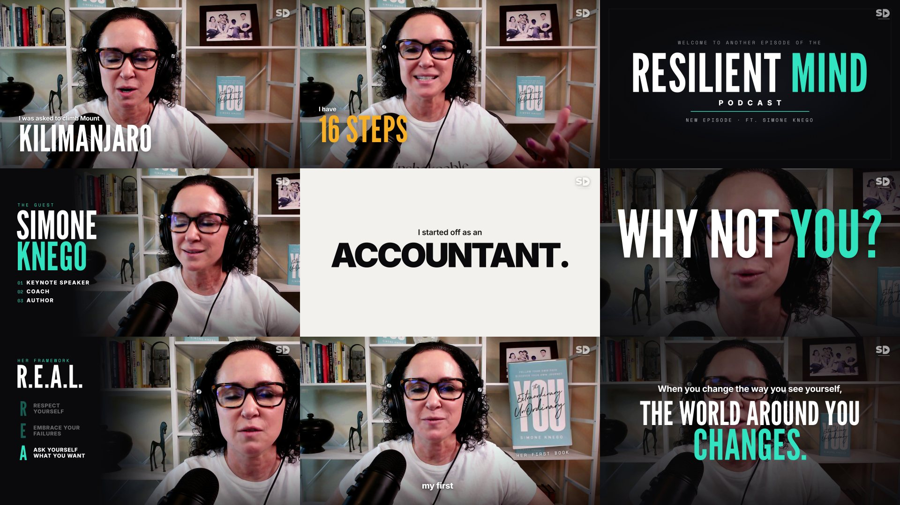

# Monkyvision — "Resilient Mind Podcast" High-Energy Intro

An 83-second 16:9 YouTube intro cut from a 49-minute remote interview, made for the **Monkyvision**
video-editor assignment. The host and the guest were recorded on separate cameras and mics. The intro was
cut, framed, graded and mixed with Python + ffmpeg, its motion graphics were built in
[HyperFrames](https://hyperframes.heygen.com) (HTML + GSAP), and it was rendered to **4K 60 fps**.



| | |
|---|---|
| **Final cut** | [`deliverables/ResilientMind_PodcastIntro_SD_4K60.mp4`](deliverables/) (3840×2160, 60 fps, 82.9 s, −15.1 LUFS, −1.8 dBTP, 38 Mbps, Git LFS) |
| **Source** | 49 min 3 s interview. Guest Simone Knego on 1080p24 (warm bookshelf); the host on 4K24 (city window). Separate video and mono 48 kHz WAV per person, one shared clock |
| **Brief** | "Identify the most engaging, impactful, and attention-grabbing moments" → a high-energy intro of about 1:20, 16:9, in the spirit of Raj Shamani, The Diary Of A CEO and Somrat Dutta. See [`BRIEF.md`](BRIEF.md) |
| **Story** | Kilimanjaro hook → title on the host's own welcome → who she is → a barrage of her sharpest lines → her R.E.A.L. framework → the descent (an abusive relationship, her mother's 1961 med school) → the comeback ("she was so wrong") → *"When you change the way you see yourself, the world around you changes."* |
| **Palette** | ink `#0A0A0C` · teal `#22D1C1` (from her book cover) · amber `#FFB020` (once, on "16 STEPS") · white |
| **Type** | League Gothic (keyword slams) · Playfair Display Italic (emphasis, quotes) · Inter (captions) · Space Mono (context chips) |
| **Grade** | per camera: the guest gets a warm S-curve with her white tee protected; the host's hazy window is cleared and his skin warmed. Soft vignette and a darker bottom for the captions. The descent is 40% desaturated and cooler |
| **Music** | original 110 BPM score generated for this film, cut on bars so its drop, stab, lift and last hit land on the title, "man's spot", "WRONG" and the end card; auto-ducked under speech |
| **Sound** | per-shot dialogue levelling, host laughs on both mics, 10 generated SFX across 39 cues, mastered to −15 LUFS |
| **Watermark** | SD mark, top-right, 62% opacity |

> The beat sheet, the full 44-shot list and the sound cues are in [`BREAKDOWN.md`](BREAKDOWN.md).
> Every asset's source and licence is in [`docs/ASSETS.md`](docs/ASSETS.md); the pipeline, render settings,
> version history and gotchas are in [`docs/PRODUCTION.md`](docs/PRODUCTION.md).

## The intro in one glance

| Time | Beat | What happens |
|---|---|---|
| 0–9.6 s | **Hook** | Cold open mid-sentence on a 1.3× punch-in: "I was asked to climb Mount **KILIMANJARO**… I said **YES.** I am not a *climber.* I live in Florida. I have **16 STEPS** in my house." Cut to the host laughing while the score falls to near-silence |
| 9.6–13.1 s | **Title** | White flash and the drop. RESILIENT MIND PODCAST slams in word by word on the host's own "Welcome to another episode of the Resilient Mind podcast" |
| 13.1–24.0 s | **The guest** | Host: "…joined by *Simone*". The guest slides right to open a SIMONE KNEGO name card, her roles ticking in as she says them. "This is *not* how I started my life" → a hard white **ACCOUNTANT.** card |
| 24.0–50.3 s | **Barrage** | "WHAT PEOPLE ASKED HER" → "Don't you think that's **SELFISH?**" → "self-care is **NEVER SELFISH.**" → "…make it **HALFWAY.**" (the host cracks up) → "Confidence is a *skill*" → full-screen **WHY NOT YOU?** → "drop the **JUST.**" with a strike-through → the host's "I don't want to know how much time I spend on social media" |
| 50.3–57.5 s | **R.E.A.L.** | Split layout: Respect yourself · Embrace your failures · Ask yourself what you want · Live without limits, each row landing on her word |
| 57.5–68.1 s | **Descent** | Up from black into a desaturated grade, the groove dying away. "I dated a guy in HIGH SCHOOL who was abusive… stuffed it down *for years.*" Then HER MOTHER · PITTSBURGH MEDICAL SCHOOL · 1961: "*You took a man's spot.*" (one score stab) |
| 68.1–75.8 s | **Comeback** | FIFTH GRADE: "a teacher told me I was not a **GOOD WRITER.**" Her book (cropped from her own shelf) slides in. The score lifts exactly on "she was **SO WRONG.**" |
| 75.8–79.4 s | **Thesis** | Slow push while the line builds on her voice: "When you change the way you see yourself, THE WORLD AROUND YOU **CHANGES.**" |
| 79.4–82.9 s | **Ident** | The show lockup on the last downbeat, "WITH SIMONE KNEGO", then "THE FULL CONVERSATION **STARTS NOW**", and a fade out |

## How it was made

1. **Reference study.** The first 95 s of nine videos (three per channel) were cut-detected, contact-sheeted and checked for audio hits. Raj Shamani gave the keyword slams, name card and host cutaways; The Diary Of A CEO gave the arc and the score dropping out for the hard part; Somrat Dutta gave the white word card and the punch-in jump cuts.
2. **Finding the moments.** The 25 strongest moments across the episode were located in the raw mic tracks by FFT cross-correlation (all 25 matched exactly) and transcribed with word timings.
3. **Cut script.** [`tools/make_edl.py`](tools/make_edl.py) holds the 44 shots: which camera, which mic, in/out and punch-in. Every cut point snaps to the quietest 5 ms, so no word is clipped. Host reactions sit under the guest's lines, and the laughs use both mics.
4. **A-roll.** [`tools/build_aroll.py`](tools/build_aroll.py) frames each punch-in on the face (OpenCV YuNet) and grades each camera separately. The 4K pass crops the host's real 4K and upscales the guest's 1080p.
5. **Motion graphics.** Seven HyperFrames scenes over the A-roll, plus generated captions (one group on screen at a time: a small lead line plus one big keyword slammed on its spoken word).
6. **Sound.** A bar-accurate edit of an original score, ducked under speech, with generated SFX placed by their measured peaks. Audio-only changes are remuxed onto the finished picture instead of re-rendered.

## Project layout

```
monkyvision-podcast-intro/
├── tools/                     # the pipeline, in run order (docs/PRODUCTION.md)
│   ├── locate_clips.py        # find the picked moments in the raw mic tracks (FFT cross-correlation)
│   ├── transcribe_windows.py  # word timings for each pick (faster-whisper)
│   ├── make_edl.py            # THE CUT SCRIPT: 44 shots, camera, mic, in/out, punch-in, energy-snapped cuts
│   ├── build_aroll.py         # cut + face-framed punch-ins + per-camera grade → A-roll, dialogue, timeline (RES=4k)
│   ├── finish_aroll.py        # vignette + descent grade → film/assets/video/
│   ├── make_words.py          # word timings on the film clock
│   ├── make_captions.py       # caption groups (the G list) → film/compositions/caps.html
│   ├── mix_audio.py           # dialogue + bar-cut score + ducking + SFX → mix.wav (−15 LUFS)
│   ├── remux_audio.py         # swap a new mix into a render without re-rendering
│   └── yunet.onnx             # face detector (MIT)
├── film/                      # the HyperFrames project
│   ├── index.html             # A-roll, camera moves (split layouts, beat kicks, push), scene hosts, flash, audio
│   ├── compositions/          # title · intro · barrage · method · story · claim · endcard · caps · wm
│   ├── assets/img/            # book card, SD watermark
│   ├── assets/film-words.json # word timings on the film clock
│   ├── assets/video/ · assets/audio/   # built A-roll and mix                                [not in repo]
│   └── SPEC.md                # look, beats and sound as numbers
├── audio/                     # the generated score (bgm_runway.mp3) and the 10 generated SFX
├── edl.json · words.json · clip_locations.json    # generated inputs the later steps read
├── deliverables/              # final 4K60 master                                           [Git LFS]
├── docs/
│   ├── ASSETS.md              # every source: origin, licence, treatment, where it lands
│   ├── PRODUCTION.md          # pipeline, render settings, versions, gotchas
│   └── media/stills.jpg       # the frame grid above
├── BRIEF.md · BREAKDOWN.md    # brief + reference study · beats, shot list, cue sheet
└── build/ · build4k/ · renders/ · frames/        # intermediates, drafts, review sheets       [not in repo]
```

## Quick start

Requirements: Git LFS, Python 3.12 (numpy, scipy, opencv-python 5.x, soundfile, librosa, faster-whisper),
ffmpeg and Node.js 18+ on `PATH`.

```bash
git lfs install && git lfs pull          # fetch the final 4K60 master
```

The supplied interview footage is not in the repo. To rebuild, point `RAW_DIR` at the folder holding it
(the two `6931f6…-video.mp4` files and their `-audio.wav` tracks; it defaults to `../Raw Footage`), then:

```bash
export RAW_DIR="../Raw Footage/Raw Footage"                   # where the supplied clips live
python -I tools/make_edl.py                                   # snap the cut script → edl.json
python -I tools/build_aroll.py                                # 1080p A-roll + dialogue + timeline
RES=4k python -I tools/build_aroll.py && python -I tools/finish_aroll.py 4k
python -I tools/make_words.py && python -I tools/make_captions.py && python -I tools/mix_audio.py
cd film && npx --yes hyperframes@0.8.216 check                # 0 errors before rendering
```

### Render the final (4K, 60 fps)

The machine this was built on has 7.4 GB RAM. One long capture crashed Chrome after about 900–1,600 frames,
so render in short segments with a fresh browser for each segment, resumable:

```bash
cd film
HF_SEGMENTED_CAPTURE=true HF_SEGMENT_FRAMES=360 HF_SEGMENT_BROWSER_RECYCLE=1 \
  npx --yes hyperframes@0.8.216 render --fps 60 --resolution 4k --quality delivery --workers 1 \
  --low-memory-mode --protocol-timeout 900000 --resume --keep-segments -o ../renders/out_4k60.mp4
cd .. && python -I tools/remux_audio.py renders/out_4k60.mp4 deliverables/ResilientMind_PodcastIntro_SD_4K60.mp4
```

That takes about 51 minutes (4,976 frames). `--resolution 4k` renders the 1920×1080 composition at device-pixel
ratio 2, so the type is natively sharp. The footage keeps its own 24p motion, while every animation and camera
move draws a new frame at 60. If only the **audio** changed, skip the render: run `mix_audio.py`, then
`remux_audio.py`, which takes about a minute.

## Version history (summary)

| Version | Change |
|---|---|
| v1 | First full render, 1080p24: 44 cuts, nine scenes, captions, generated score |
| v2 | Captions are clamped so they never print over full-frame cards (the ACCOUNTANT overlap) |
| v3 | Every sound effect regenerated, so no attribution or unknown licences remain; audio remuxed onto v2's picture |
| **4K60 (final)** | A-roll rebuilt at 3840×2160 (host native 4K, guest upscaled), rendered at 60 fps in 4K |

Full details are in [`docs/PRODUCTION.md`](docs/PRODUCTION.md#versions).

## Credits

- Footage: the *Resilient Mind Podcast* interview with Simone Knego, supplied by Monkyvision for the assignment
- Music: original score generated for this film (Runway, ElevenLabs music model)
- Sound effects: 10 originals generated for this film (Runway sound effects, ElevenLabs model)
- Fonts: League Gothic, Playfair Display, Inter, Space Mono (SIL OFL, bundled with HyperFrames)
- Face detection: OpenCV YuNet (MIT)

No third-party audio is used, so nothing needs to be credited when the video is posted.

## Rights

The interview footage belongs to its owners and was supplied for this test only. The source media is not
committed, but the final cut in `deliverables/` contains it, so don't republish it outside a portfolio or
test context. The score, sound effects and graphics were made for this project; the SD watermark is the
author's own.
